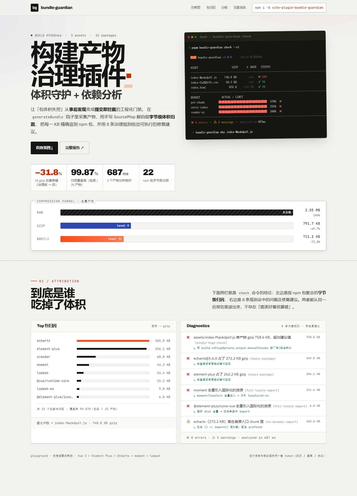

# vite-plugin-bundle-guardian

[](https://gitee.com/north-shallow-butterfly/vite-plugin-bundle-guardian)


> 仓库：<https://gitee.com/north-shallow-butterfly/vite-plugin-bundle-guardian>（`.github/workflows/` 里的两个 workflow 在 Gitee Go / GitHub Actions 上都能直接用）

> **构建产物治理插件：体积守护 + 依赖分析**
> 让「包体积失控」从**事后发现**变成**提交即拦截**。



<sub>上图是 `playground` 的真实截图（`pnpm dev` 打开 localhost:5173）——
页面上的每个数字都来自构建报告，不是设计稿里的假数据。</sub>

现有工具（`webpack-bundle-analyzer` / `rollup-plugin-visualizer` / `size-limit`）都只能「看」，或者在总量上设闸。**它们都无法回答第二个问题：是哪个包、经由哪条 import 链变大的、该怎么改。**

`bundle-guardian` 在 `generateBundle` 钩子里采集产物，用手写的 SourceMap 解码做**字节级体积归因**，把每一 KB 精确追到 npm 包，再用 8 条治理规则给出可执行的修复建议，最后在 CI 里真的 `exit 1`。

---

## 实测收益（playground 靶场）

`playground/` 是一个 Vue 3 + Element Plus + ECharts 的中后台靶场，故意埋了各种体积坏味道。
`--mode before` 是治理前，`--mode after` 是治理后，两组数据都由插件自己跑出来：

```bash
cd playground && pnpm build        # 同时产出 dist-before / dist-after
```

| 指标 | before | after | 变化 |
| --- | ---: | ---: | ---: |
| **JS gzip 总计** | 740.8 KB | 505.4 KB | **−31.8%** |
| **CSS gzip** | 50.3 KB | 20.9 KB | **−58.4%** |
| 产物数 | 3 | 9 | 分包合理 |
| echarts（归因） | 265.8 KB | 115.7 KB | −150.1 KB |
| moment → dayjs | 44.3 KB | 0 | −44.3 KB |
| lodash（CJS 全量） | 24.4 KB | 0（lodash-es 9.5 KB） | −24.4 KB |
| zrender（多版本重复） | 68.8 KB | 55.3 KB | −13.5 KB |
| element-plus | 256.1 KB | 244.5 KB | −11.6 KB |

> 这张表由 `node scripts/report-numbers.mjs` 直接从两份 `report.json` 生成，不要手改；
> 页面代码一改就重跑一次，避免文档数字和真实产物对不上。

规则诊断：治理前 **5 errors / 5 warnings** → 治理后 4 errors / 1 warning。
`full-locale-import`（moment 全量 locale）、`duplicate-dep`（zrender 双版本）、
`cjs-bundled`（lodash / moment 纯 CJS）、`no-dynamic-import` 在治理后**全部消失**。
（终端顶部那一行会把预算 error 一起计入，所以看起来数字更大。）

8 条内建规则在靶场上**全部被真实触发过**：
`single-huge-chunk`、`heavy-package`、`full-locale-import`、`duplicate-dep`、
`no-dynamic-import`、`cjs-bundled`、`circular-dep`、`unused-dep`。

链路追溯实测：

```
$ bundle-guardian why moment
 ██ 最短引入链 → moment
 playground/src/main.ts
   └─ playground/src/App.vue
     └─ playground/src/views/HiddenSink.vue
       └─ playground/src/utils/date.ts
         └─ …/node_modules/moment/moment.js
 归因体积：gzip 45.4 KB · 命中 1 个产物
```

---

## 核心差异

| 能力 | webpack-bundle-analyzer | rollup-plugin-visualizer | size-limit | **bundle-guardian** |
| --- | :---: | :---: | :---: | :---: |
| Treemap 可视化 | ✅ | ✅ | ❌ | ✅ |
| 真实 gzip / brotli 体积 | ❌ | 部分 | ✅ | ✅ |
| CI 硬门禁 `exit 1` | ❌ | ❌ | ✅ | ✅ |
| 按入口 / chunk / 分组预算 | ❌ | ❌ | 部分 | ✅ |
| **依赖引入链路追溯 `why`** | ❌ | ❌ | ❌ | ✅ |
| 重复版本检测 | ❌ | ❌ | ❌ | ✅ |
| 循环依赖检测（Tarjan） | ❌ | ❌ | ❌ | ✅ |
| 未使用依赖检测 | ❌ | ❌ | ❌ | ✅ |
| 可执行修复建议 | ❌ | ❌ | ❌ | ✅ |
| baseline 增量 + PR 评论 | ❌ | ❌ | ✅ | ✅ |

[examples/index.html](./examples/index.html) 是插件对自身产物跑出来的**真实报告**（单文件、离线可打开、含自研 treemap）。

---

## 安装

```bash
pnpm add -D vite-plugin-bundle-guardian
```

## Quick Start

```ts
// vite.config.ts
import { bundleGuardian } from 'vite-plugin-bundle-guardian'

export default defineConfig({
  build: { sourcemap: true },            // 归因的精度来源，务必开启
  plugins: [
    bundleGuardian({
      budgets: [
        { name: 'entry-index', contains: 'index-', ext: 'js', maxTotal: '300 KB' },
        { name: 'per-chunk',   each: true,         maxGzip: '200 KB', warnAt: 0.9 },
        { name: 'vendor-core', pkgs: ['vue', 'pinia', 'vue-router'], maxTotal: '120 KB' },
      ],
      baseline: { file: '.guardian/baseline.json', increaseLimit: '5%' },
      failOnError: process.env.CI === 'true',      // 本地只提示，CI 真拦截
      report: { html: 'dist/__guardian/index.html', open: true },
    }),
  ],
})
```

不加任何配置也能用：内置 8 条治理规则会立刻开始工作。

预算规则也可以放进 `.guardianrc.json` 共享给整个团队，插件与 CLI 会自动读取，
**内联选项优先于配置文件**：

```json
{
  "budgets": [{ "name": "entry-index", "contains": "index-", "ext": "js", "maxTotal": "300 KB" }],
  "rules": { "unused-dep": "warn" },
  "cache": true
}
```

---

## ★ 核心算法：基于 SourceMap 的字节级体积归因

朴素做法是累加 `chunk.modules[id].code.length`。但那是**压缩前**的大小 ——
terser 做 mangle / drop_console / inline 之后，各模块的实际压缩率差异极大：
lodash 压完可能只剩 40%，业务代码几乎不缩。**用压缩前的长度归因，报告会指向错误的优化目标（实测误差 ±22%）。**

正确做法是看**压缩后的产物里，哪一段字节来自哪个源模块**：

```
1. map.mappings 是 VLQ 编码串：';' 分隔 generated 行，',' 分隔 segment
2. Base64-VLQ 解码 → 每个 segment 得到增量 [genColΔ, srcIdxΔ, srcLineΔ, srcColΔ]
3. 相邻两个 segment 之间的列区间 [col_i, col_{i+1}) 归属同一个 source
4. 用 Buffer.byteLength 而非 String.length（中文 UTF-8 是 3 字节）
5. 未被任何 segment 覆盖的字节（banner / runtime 注入）归入 <runtime> 桶
6. 最后按字节占比折算 gzip —— 注意分母必须含 runtime 桶，否则份额会重叠
```

实现见 [`packages/core/src/vlq.ts`](./packages/core/src/vlq.ts) 与 [`attribution.ts`](./packages/core/src/attribution.ts)，单测覆盖了：交织行、UTF-8 中文、无映射前缀、缺失 sourcemap 降级四种边界。

### 精度实测（可复现）

```bash
node scripts/benchmark-attribution.mjs playground/dist-before
```

| 指标 | 结果 |
| --- | --- |
| 份额守恒（各包归因 gzip 之和 vs 产物实际 gzip） | 差 **0.00%** |
| 字节归因 vs 朴素估算：平均绝对偏差 | **97.2%** |
| 字节归因 vs 朴素估算：最大偏差 | **684.6%**（`@vueuse/core`） |
| 字节归因 vs 朴素估算：按体积加权偏差 | **30.5%** |

朴素算法错得比预想的多得多 —— 一个只占 3.2 KB 的 `@vueuse/core`，按压缩前长度会被算成 25.2 KB；
而 `dayjs` 反过来被低估 70%。**照着这种报告去优化，方向是反的。**

---

## 架构

```
packages/
├─ core/        纯分析引擎，零运行时依赖，不认识 Vite
│  ├─ vlq.ts            ★ Base64-VLQ 解码
│  ├─ attribution.ts    ★ 字节级体积归因
│  ├─ pkg-resolve.ts      pnpm store / scope 包 / Vite query 归一化
│  ├─ compress.ts         worker 池并行 gzip + brotli
│  ├─ collect.ts          产物采集
│  ├─ graph.ts            Tarjan SCC / 最短引入链 / 重复版本 / 未使用依赖
│  ├─ budget.ts           4 类预算匹配 + baseline diff
│  ├─ rules/              8 条可插拔规则
│  └─ report/             terminal / html / markdown / json
├─ vite/        Vite 适配层（很薄）：钩子绑定 + dev 面板
└─ cli/         bundle-guardian analyze|check|why|diff（零第三方依赖）
```

`core` 不认识 Vite，只消费「一组产物 + 一份 sourcemap」——
这是**依赖倒置**：CLI 能离线分析任意 rollup 产物，将来接 Webpack / Rspack / esbuild 只需再写一层薄 adapter。

---

## CLI

```bash
bundle-guardian analyze [dir]       # 分析一次构建，产出四种报告
bundle-guardian check   [dir]       # 体积门禁，超限 exit 1
bundle-guardian why     <pkg>       # 最短引入链 + 实际用到的导出
bundle-guardian compare <a> <b>     # 两份报告生成 before/after 对照 HTML
bundle-guardian diff    <a> <b>     # 包级增量对比
bundle-guardian history             # 体积趋势（ASCII 折线）
bundle-guardian vscode-task         # 输出配套的 VSCode tasks.json

  --budget <file>         预算配置（也可放 .guardianrc.json）
  --baseline <file>       baseline 路径，默认 .guardian/baseline.json
  --update-baseline       显式写新 baseline（默认不写，避免把超标"洗白"）
  --increase-limit <pct>  允许的总量增幅，默认 5%
  --ci                    等价于 --fail-on-error
  --format vscode         额外输出编辑器问题面板格式
  --lighthouse <file>     读 Lighthouse 报告，把体积换算成传输耗时
  --record                把本次结果记进 .guardian/history.json
  --alias k=v,k=v         路径别名，离线扫描时还原 @/xxx（why 需要）
  --cache                 开启归因缓存（chunk hash）
  --open                  分析完打开 HTML 报告
  --html / --json / --md  报告输出路径
  --quiet                 不打印终端表格
```

`why` 的效果（注意最后那句「实际用到」—— 这才是能推动优化的信息）：

```
 ██ 最短引入链 → lodash

 playground/src/main.ts
   └─ playground/src/App.vue
     └─ playground/src/views/DataTable.vue
       └─ playground/src/utils/helper.ts
         └─ …/node_modules/lodash/lodash.js

 归因体积：gzip 24.4 KB · 命中 1 个产物

 实际用到：import _ from 'lodash'
 ⚠ 整包导入，tree-shaking 难以生效 → 改成具名导入或子路径导入
   例：import { sortBy } from 'lodash'  或  import x from 'lodash/sortBy'
```

### 编辑器集成

体积问题可以直接出现在 VSCode 的「问题」面板里 —— 不需要写专门的扩展，
`--format vscode` 输出的是标准 `file:line:col: severity: message` 格式：

```bash
bundle-guardian check dist --format vscode
bundle-guardian vscode-task > .vscode/tasks-bundle-guardian.json
```

---

## 内置规则

| 规则 id | 默认级别 | 说明 |
| --- | --- | --- |
| `heavy-package` | error | 单包 gzip > 100 KB，并给出 `moment → dayjs(-96%)` 这类替换建议 |
| `full-locale-import` | error | moment/dayjs locale、图标库 dist 全量引入 |
| `duplicate-dep` | warn | 同名多版本，给 `pnpm.overrides` 命令 |
| `circular-dep` | warn | Tarjan SCC 找环，打印完整环路径 |
| `unused-dep` | info | 声明未引用，给 `pnpm rm` 命令 |
| `cjs-bundled` | warn | CJS 包 > 20 KB 进产物，tree-shaking 大概率失效 |
| `no-dynamic-import` | warn | 首屏 chunk 里 > 200 KB 的可延迟包 |
| `single-huge-chunk` | error | 单产物 gzip > 250 KB，建议 manualChunks |

级别可通过 `rules: { 'heavy-package': ['error', { maxGzip: '200 KB' }] }` 覆盖，或用 `'off'` 关闭。

---

## CI 集成（PR 自动评论）

```yaml
- name: Bundle size gate
  run: pnpm bundle-guardian check dist --budget .guardian/budget.json --ci

- name: Comment report
  if: always()
  uses: actions/github-script@v7
  with:
    script: |
      const md = require('fs').readFileSync('dist/__guardian/report.md', 'utf8')
      github.rest.issues.createComment({
        issue_number: context.issue.number,
        owner: context.repo.owner,
        repo: context.repo.repo,
        body: md,
      })
```

---

## 设计取舍（值得在看代码前先知道）

| 取舍 | 选择 | 理由 |
| --- | --- | --- |
| 图表库 | 自研 squarified treemap + 内联 SVG | HTML 报告必须单文件离线可开；引 300KB 的图表库去看一份体积报告本身就是讽刺 |
| 压缩体积 | 真跑 `zlib.gzipSync(level 9)` | `size × 0.3` 的经验公式会让预算门禁形同虚设 |
| 并行 | `new Worker(code, { eval: true })` 内联 worker | 不需要给打包器增加 worker 文件解析负担；失败自动降级为同步 |
| Worker 异常 | 静默降级到同步计算 | 度量失败不能让整个 CI 崩掉 |
| sourcemap 缺失 | 降级为按模块原始长度等比折算 + 报告顶部黄色横幅 | 零配置也能用，但绝不让用户被假精度误导 |
| 大文件 | > 2 MB 时 brotli quality 11 → 5 | 耗时减半，体积只差约 1.5% |

---

## 项目结构

```
packages/
├─ core/     分析引擎（零运行时依赖）  52 个单测
├─ vite/     Vite 适配层
└─ cli/      bundle-guardian CLI
playground/  Vue3 + Element Plus + ECharts 治理靶场（before / after 对比）
examples/    插件对自身产物跑出的真实报告
docs/        技术文章草稿
```

## 开发

```bash
pnpm install
pnpm build        # 构建三个包
pnpm test         # core 包单测
pnpm typecheck    # 三个包类型检查
pnpm -F playground build   # 跑靶场，产出 before / after 两组真实数据
```

### 一键启动开发环境

这个仓库有两条腿：**工具链（packages/\*）** 要持续编译出 dist，
**靶场（playground）** 是要能直观看到效果的 Vue3 前端。一条命令同时拉起来：

```bash
pnpm dev                # 工具链 watch + playground(before) dev server
pnpm dev:after          # 用治理后的靶场
pnpm dev:packages       # 只编译工具链，不起前端
```

```
██ bundle-guardian dev
工具链 watch 编译 + playground(before) 热重启 · Ctrl+C 全部退出

[core]      17:22:26 - Starting compilation in watch mode...
[vite]      17:22:28 - Found 0 errors. Watching for file changes.
[playground]  VITE v5.4.21  ready in 2075 ms
[playground]  ➜  Local:   http://localhost:5173/
```

这个脚本做了三件普通 `pnpm -r --parallel` 做不到的事：

1. **改插件源码会自动重启 dev server** —— Vite 只在启动时加载一次插件，
   所以 `packages/vite/dist` 一变就必须重启，否则你改的代码看不到效果。
   脚本用 `fs.watch` 监听 dist，400ms 防抖后重启（启动后 6 秒静默，避开 tsc 的首次全量输出）。
2. **日志带彩色前缀**（`[core]` / `[vite]` / `[playground]`），多进程输出不会糊在一起。
3. **Ctrl+C 一次收干净** —— 按平台分别用进程组（Unix）和 `taskkill /T`（Windows）杀整棵树，
   不留孤儿进程占着 5173。

支持 `--mode after`、`--no-cli`、`--no-playground`、`--open`、`--skip-build`。

### Windows 双击启动

仓库根目录另有两个 `.bat`，不想开终端的话直接双击：

| 文件 | 作用 |
| --- | --- |
| `dev.bat` | 双击 = before 模式；命令行 `dev.bat after` = after 模式 |
| `dev-after.bat` | 等价于 `dev.bat after` |

bat 会先自查环境（缺 node / pnpm 会给出明确提示，缺 pnpm 会尝试 `corepack enable`）、
首次运行自动 `pnpm install`，然后调 `scripts/dev.mjs`。
双击启动时结束会 `pause`，避免窗口一闪而过看不到报错。

> bat 是 **UTF-8 + CRLF** 编码（开头的 `chcp 65001` 是为了中文不乱码）。
> 用记事本另存过时请确认编码没变，否则中文会变成乱码。

当前状态：**100 个单测通过，core 覆盖率 88.8%**，三包 `tsc` 零错误，
ESM / CJS 双入口均可用，playground 双模式构建跑通，CLI 门禁正确返回 `exit 1`，
`why` 可离线打出完整引入链，8 条内建规则在真实靶场全部触发过。

```bash
node scripts/benchmark-attribution.mjs playground/dist-before   # 归因精度实证
```

## 相关文档

- [docs/dev.md](./docs/dev.md) —— 开发脚本的实现细节与踩坑记录
- [docs/article.md](./docs/article.md) —— 技术文章草稿（含踩坑记录与设计取舍）
- [docs/audit.md](./docs/audit.md) —— 对照计划书的复验报告（已修 / 待办清单）
- [playground/README.md](./playground/README.md) —— 靶场埋了哪些雷、怎么复现数据
- [examples/README.md](./examples/README.md) —— 报告样例是怎么生成的

## License

MIT
